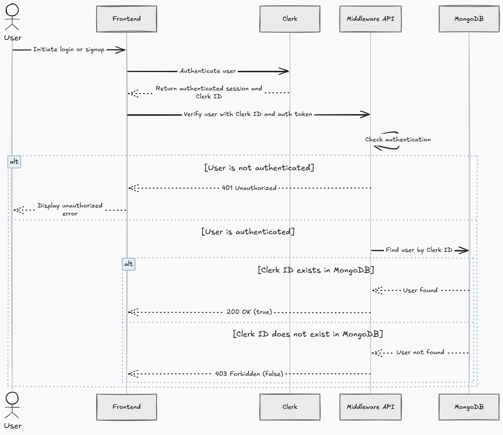

# Module 1 - Account & Authentication

<aside>

**Building APIs to manage account/profile, authentication and authorization with Clerk.**

1. Sync **Clerk** user to the **MongoDB.**
2. Check if the logged in **Google** account with **Clerk ID** account exists in the **MongoDB.**
3. Update user account information.
4. Delete user account.
</aside>

## 1.1 - Sync Clerk user to MongoDB.

1. User is on the landing page at `/` and user hits the **Get Started** button.
2. A **Google OAuth 2.0** authorization is triggered and user chooses the account to login.
   1. If succeeds, **status 200** → redirect to `/sso-callback` to verify and then to `/authorization` .
   2. If fails, **status 500** → stay on `/` and try again.
3. Once user get redirected to `/authorization` page, start the syncing process.
4. Check whether the user with the **clerk ID** exists in the **MongoDB.**
   1. If user exists, throw account exists error and throw an error of **account existence**, then logout from the frontend after a delay.
5. Redirect to `/profile/signup` where details will be fetched in the input from the token authorized by **Google OAuth 2.0** and only **Name** can be changed i.e not the **Email** address.
   1. If the inputs are empty then throw error and do not proceed (Continue button stays disabled).
   2. Store the name value in a state field and Continue to the next page.
6. After hitting continue, redirect to `/profile/signup/allergy` where **AI agent** asks you questions related to user’s **allergies**.
   1. These questions can be skipped ins signup process and can be completed later again. Though these **AI agent** questions are necessary before uploading **medical prescription**.
   2. **AI agent** will keep asking questions until user say something like **that is it** or **it is enough**.
   3. Once completed, **AI agent** will **summarize** all the **allergies** back to the user and ask again if there are any changes needed.
      1. If **no**, user will just say no and **AI agent** will understand, confirm and lock it.
      2. If **yes**, then user will type and **AI agent** will again **summarize** back to the user and ask again if there are any changes needed.
   4. In the last process of the signing up, user is redirected to the `/profile/signup/review` page and verify all the filled in information.
      1. If any changes are needed to be done, user do it right there.
   5. User hit the **Submit** button.
      1. If process is completed successfully, **status 201** → User get’s saved in the **MongoDB**.
      2. If process is failed, **status 500** → Throw appropriate error.
      3. For syncing process, user must be authenticated, if not then **status 401** → Throw unauthorized error.

## 1.2 - Verifying user to get Authenticated and Authorized.

1. This API is used only in logging in and signing up process.
2. After successfully getting **token** from the **Google OAuth 2.0** process, redirect to `/authorization` page.
3. This is the middleware API that checks whether the logged in user’s **clerk ID** matches any **clerk ID** in the **MongoDB**.
   1. If yes, **status 200** → it returns **true** then \***\*redirects to the appropriate page**.\*\*
   2. If no, **status 403** → it returns **false**.
4. For verifying process, user must be authenticated, if not then **status 401** → Throw unauthorized error.
