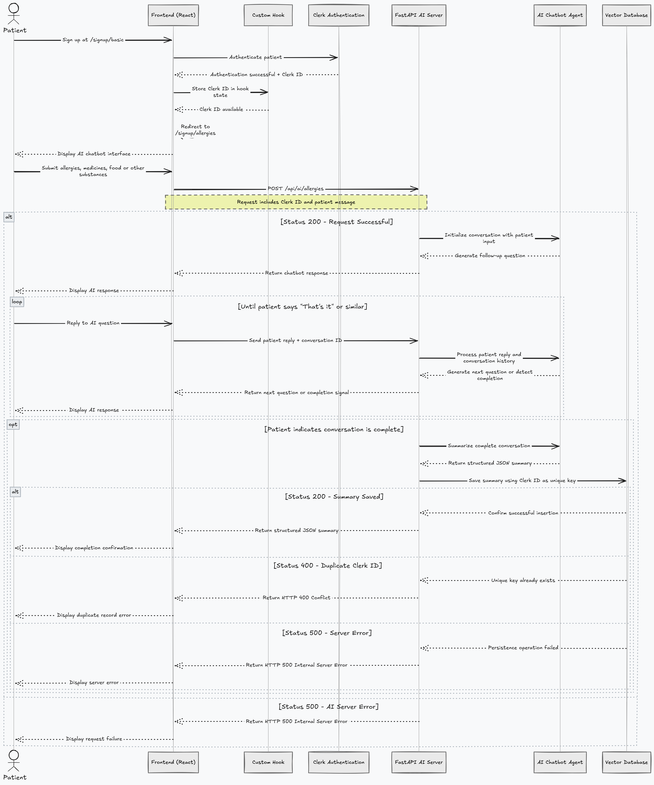
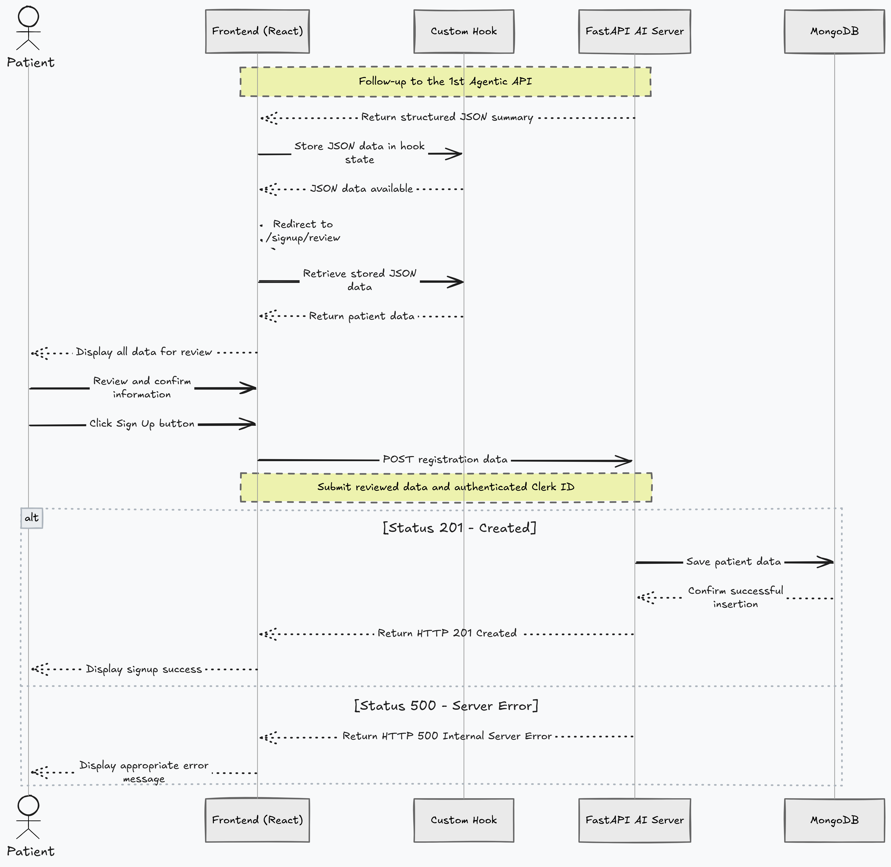

# Module 2 - Allergies and Medicines Chatbot

<aside>

**Building Generative AI Agents and APIs to manage patient’s allergies and medicinal information.**

1. **AI Agent** to chat with the patient about their allergies, then summarize the data into a structured **JSON**.
2. Save the structured **JSON** data into the **MongoDB**.
3. **Fetch** the allergies and medicines summary of a particular patient (**tenant)** via **authentication-token**.
4. Erase **memory** by deleting the information saved in **VectorDB**, and **MongoDB** for a patient.
5. Update the memory by again running the same process as 1. and 2. for a patient.
</aside>

## 2.1 - Chat with patient about their allergies.

1. Once the patient is **authenticated** while **signing up** to the app on the **`/signup/basic`**, get the **clerk ID** from the **frontend** in a state via custom **hook.**
2. Redirect to **`/signup/allergies`** , patient will be asked to elaborate about the allergies from any medicines that they are taking or my food or any other substances by the **AI agent**.
3. Once the patient is done explaining and sends the reply to **AI agent**:
   1. From **frontend** it goes directly to **FastAPI AI server `/api/ai/allergy` .**
      1. **question, clerk ID as patientId and chatHistory** is sent as the **body** in **post method**.
         1. **Status 200** **→ FastAPI AI server** responds with **response, isCompleted, summaryData and chatHistory**.
         2. In **frontend** we do not stop the chatting process and redirect to **`/signup/review`** until the **summaryData** is **not null** and **isCompleted** is **True**.
         3. Start with **chatHistory** state as an empty array, then keep updating with newly returned **chatHistory** array until **isCompleted** is true.
         4. Once **isCompleted** is returned true that means **summaryData** isn’t null anymore, so get the **allergies** array field from **summaryData**, update it with **setAllergies** state**.**
         5. The data is also saved in **Chroma (vector database)**.
         6. Redirect to **`/signup/review` ,** review all the information of the user and hit **Sign Up** button.
         7. **Status 500** → Throw appropriate error message**.**
         8. **Status 403** → Throw appropriate error message if **Gemini API** has any issues**.**
   2. This will use all the states holding the values and hit the **business logic server** endpoint to register the user account.
      1. **Status 201** → User information get’s saved to **MongoDB.**
      2. **Status 500** → Throw appropriate error message.
      3. **Status 401** → Throw appropriate error message if user is not **authenticated**.

## 2.2 - Save allergies JSON data to MongoDB.

1. This API is the follow-up of the **1st Agentic API.**
2. Once the **JSON** data is return, store it in a state of custom **hook**.
3. Redirect to **`/signup/review`** , fetch all the data to review.
4. Confirm and hit **Sign Up** button.
   1. **Status 201** → Save all the data to MongoDB.
   2. **Status 500** → Throw appropriate error message.

## 2.3 - Fetch allergy summarization of a patient.

This is handled by **API - 1.3**.

## 2.4 - Update allergy summarization of a patient.

1. From **`/friede/settings`** page, patient hits **Update Allergy Data** button.
2. This triggers the erase memory first ref. **API - 2.5**.
   1. Deletes allergy information from **MongoDB**.
   2. Deletes allergy information from **Chroma Vector DB** with **clerk ID**.
3. Then after erasing memory, it redirects to **`/friede/allergy`** .
4. Same process as before ref. **API - 2.1 and 2.2**.
5. Once the summarization is return via a structured **JSON** data:
   1. **Status 200 →** Update it to **MongoDB** for the **authorized** and **authenticated** patient.
   2. **Status 500** → Throw appropriate error message.
6. Patient must be authenticated before using this feature.
   1. If not, **status 401** → Throw unauthorized error message.
7. If patient doesn’t want to set allergy, it can be skipped.

## 2.5 - Delete allergy summarization of a patient.

1. From **`/friede/settings`** page, patient hits **Erase Memory** button.
2. This first triggers the **API** of **business login server** and deletes allergy information from **MongoDB**.
3. Then, this triggers the **API** of **AI agent server** and deletes allergy information from **Chroma Vector DB** with **clerk ID**.
4. Then after erasing memory, it redirects to **`/friede/allergy`** .
5. Same process as before ref. **API - 2.1 and 2.2**.
6. Once the summarization is return via a structured **JSON** data:
   1. **Status 200 →** Update it to **MongoDB** for the **authorized** and **authenticated** patient.
   2. **Status 500** → Throw appropriate error message.
7. User must be authenticated before using this feature.
   1. If not, **status 401** → Throw unauthorized error message.
8. If patient doesn’t want to set allergy, it can be skipped.
